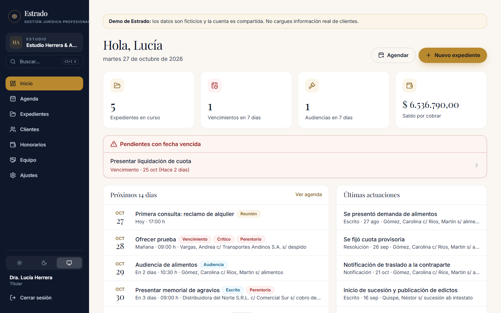
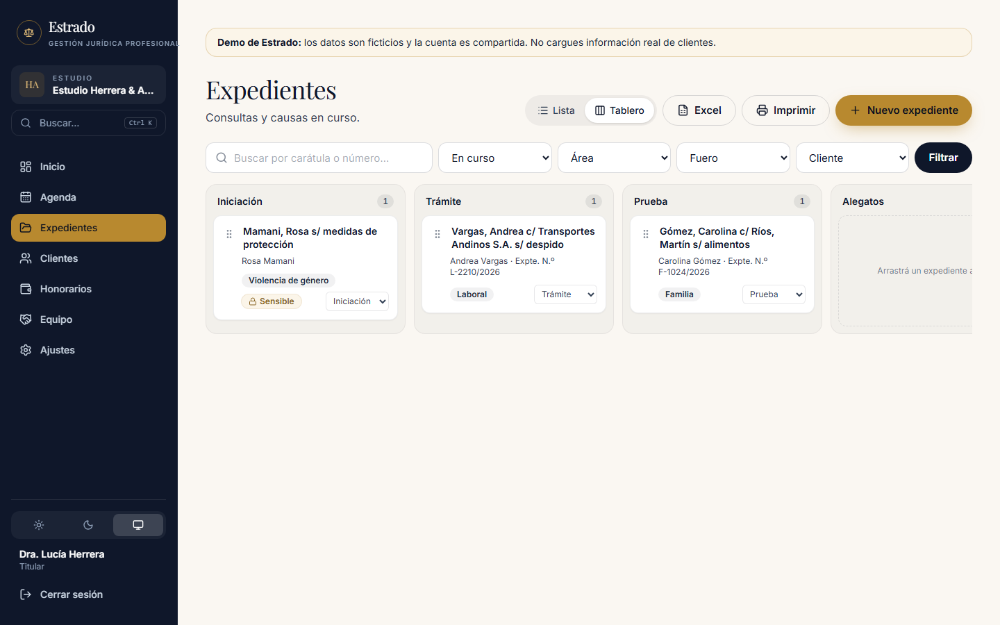
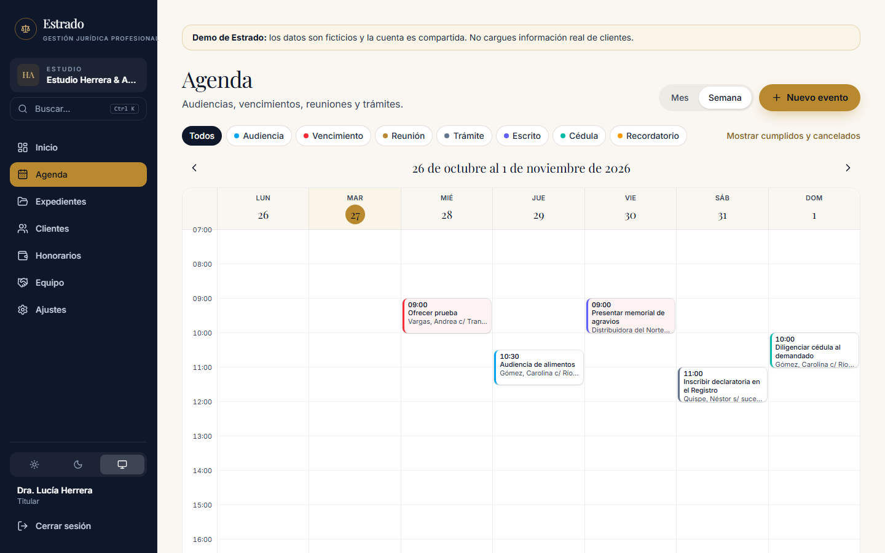
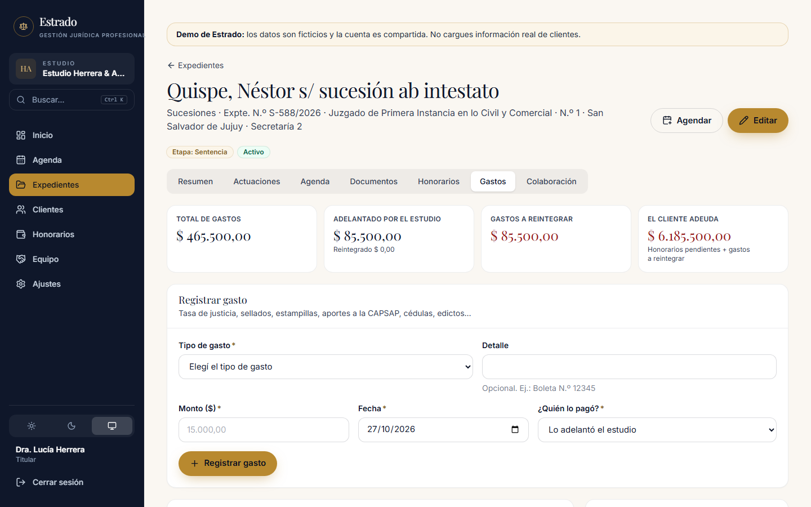
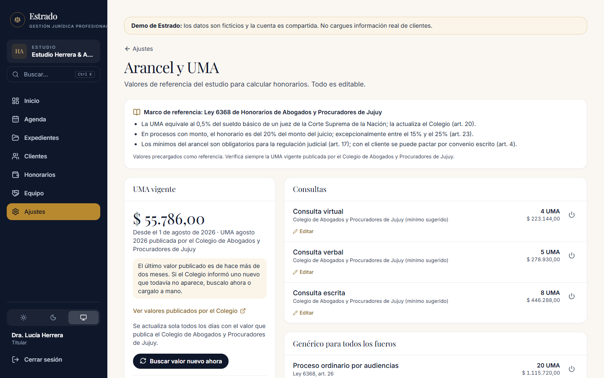
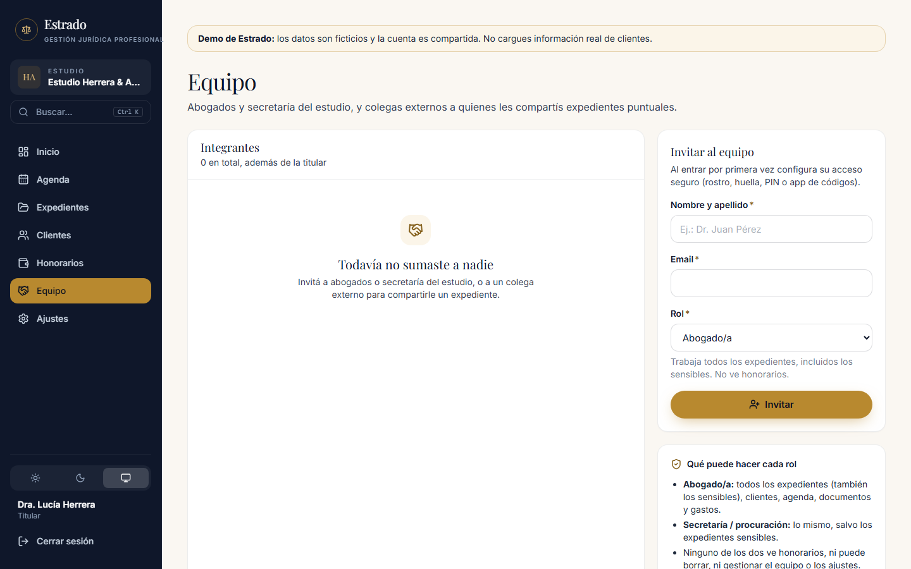
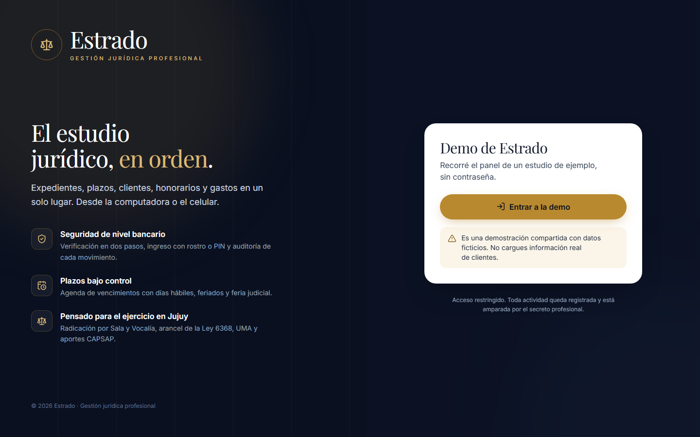
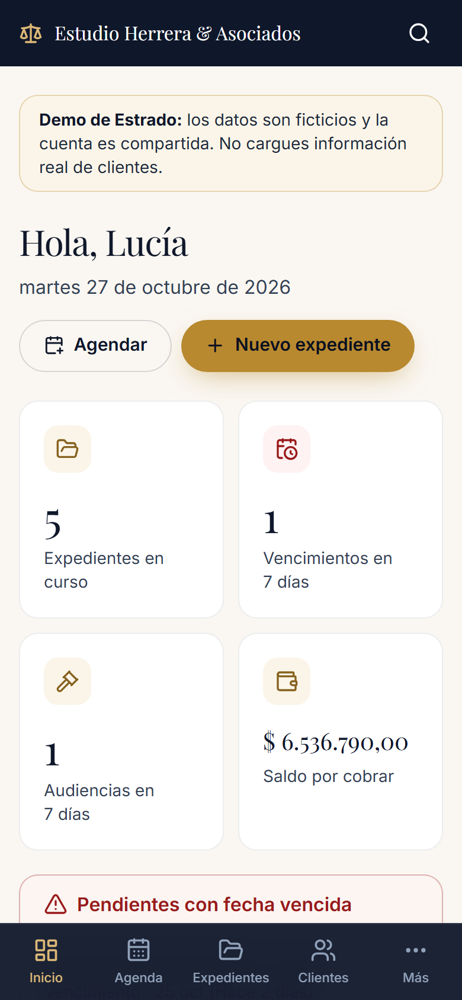
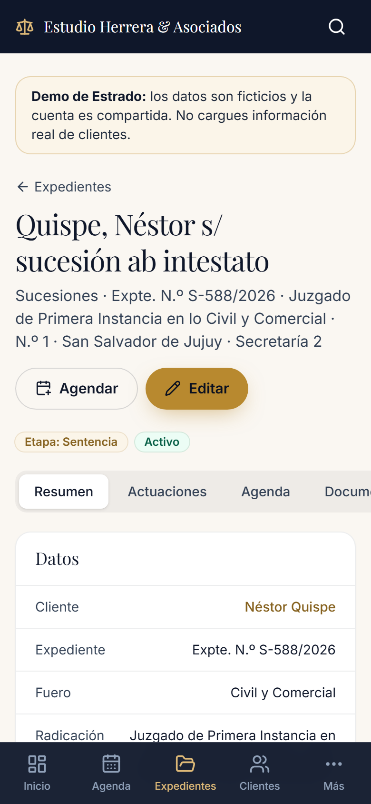
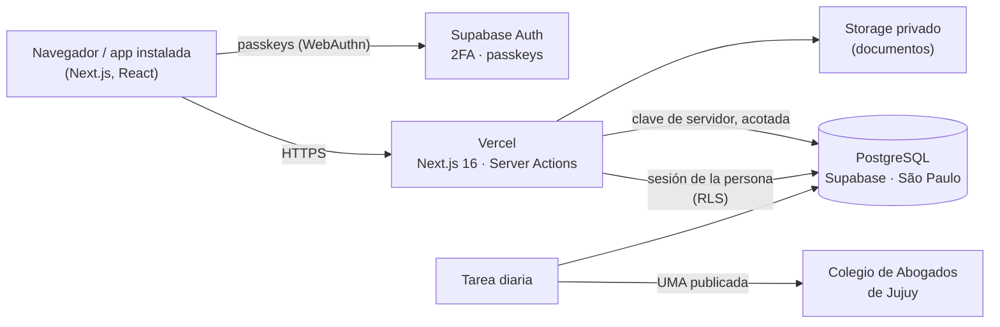

# ⚖️ Estrado

### Gestión jurídica profesional para estudios de abogados de Argentina

**[▶ Probar la demo en vivo](https://estrado-demo.vercel.app/acceso)** — se entra con un botón, sin registrarse (datos ficticios).
&nbsp;·&nbsp; **[Pedir una prueba gratis de 30 días](https://web-alpha-steel-31.vercel.app/prueba)**

---

## Qué es

Estrado es un sistema en la nube para que un estudio jurídico lleve en un solo lugar sus **expedientes, plazos, clientes, documentos, honorarios y gastos**, desde la computadora o el celular. Nació de la práctica real de una abogada de Jujuy, que lo usa con sus casos y aporta sus devoluciones como primera usuaria.

> **Producto en desarrollo activo.** El código fuente es privado; este repositorio muestra el producto, sus decisiones técnicas y cómo probarlo.

## Funcionalidades

| | |
|---|---|
| 📁 **Expedientes** | Carátula, partes, etapa procesal (con tablero arrastrable), actuaciones, documentos y radicación según la organización judicial de Jujuy: Sala y Vocalía o Juzgado y Secretaría, según el organismo. |
| 📅 **Agenda de plazos** | Vencimientos, audiencias y cédulas; cómputo en **días hábiles** con feriados y feria judicial; plazos perentorios destacados; vista mensual y semanal. |
| 💰 **Honorarios** | Arancel de la **Ley 6368** precargado, cálculo en UMA, pagos parciales y saldo. La **UMA se actualiza sola** con el valor que publica el Colegio de Abogados de Jujuy. |
| 🧾 **Gastos del expediente** | Tasa de justicia, sellados, estampilla profesional, aportes **CAPSAP**, cédulas, edictos…, con reintegros del cliente y balance de cada caso. |
| 👥 **Equipo** | Roles de titular, abogado/a, secretaría/procuración y colaborador externo, con permisos distintos para cada uno. |
| 📱 **App instalable** | Se instala en el celular o la computadora (PWA) y se adapta a cualquier pantalla. |
| 🎁 **Prueba gratis** | Cada estudio nuevo usa el sistema completo durante 30 días; al terminar, sus datos quedan en solo lectura (nunca se pierden) hasta que activa su plan. |
| 📊 **Listados** | Expedientes y clientes para Excel o impresión, con el balance de cada caso. |

<table>
<tr>
<td width="50%"> Tablero por etapa procesal</td>
<td width="50%"> Agenda semanal</td>
</tr>
<tr>
<td> Gastos y balance del expediente</td>
<td> Arancel de la Ley 6368 y UMA automática</td>
</tr>
<tr>
<td> Equipo y roles</td>
<td> Acceso</td>
</tr>
</table>

  
  &nbsp;&nbsp;
  

## Seguridad

La información de un estudio está amparada por el **secreto profesional** y la **Ley 25.326** de datos personales. La seguridad se diseñó en capas:

- **Verificación en dos pasos obligatoria.** Se elige entre el desbloqueo del dispositivo (passkeys: rostro, huella o PIN, resistentes al phishing) y una app de códigos. Hay **códigos de recuperación** de un solo uso, guardados como hash.
- **Autorización en la base de datos** (Row Level Security de PostgreSQL): cada estudio está aislado de los demás y cada rol accede solo a lo suyo. Un error en la interfaz no puede exponer datos ajenos.
- **Documentos privados** con enlaces de descarga que vencen en 60 segundos.
- **Auditoría** de cada alta, cambio, borrado y descarga.
- La app instalable **no guarda datos de clientes** en el dispositivo.
- Encabezados de seguridad (CSP, HSTS y otros), sin registro público y con límite de intentos de acceso.

## Arquitectura

- **Frontend y servidor:** Next.js 16 (App Router, Server Components, Server Actions), React 19, TypeScript estricto y Tailwind CSS 4.
- **Datos y acceso:** Supabase (PostgreSQL 17, Auth con TOTP y passkeys, Storage), con permisos definidos en la base mediante RLS.
- **Validación:** Zod en el servidor y en el navegador.
- **Despliegue:** Vercel, con tareas programadas (Vercel Cron).

## Calidad

- **+100 pruebas de extremo a extremo** con Playwright: flujos completos de ingreso (incluidas passkeys con un autenticador virtual), expedientes, agenda, honorarios, gastos, roles y adaptación al celular.
- **+80 pruebas de seguridad de la base de datos** con pgTAP: aislamiento entre estudios, permisos por rol, expedientes sensibles, acceso sin 2FA y modo solo lectura por plan.
- Base de datos versionada con migraciones y entornos separados (local, demo y producción).

---

**© 2026 — Todos los derechos reservados.** El código fuente de Estrado es privado.

¿Te interesa para tu estudio? **[Pedí tu prueba gratis](https://web-alpha-steel-31.vercel.app/prueba)** o **[recorré la demo](https://estrado-demo.vercel.app/acceso)**.

